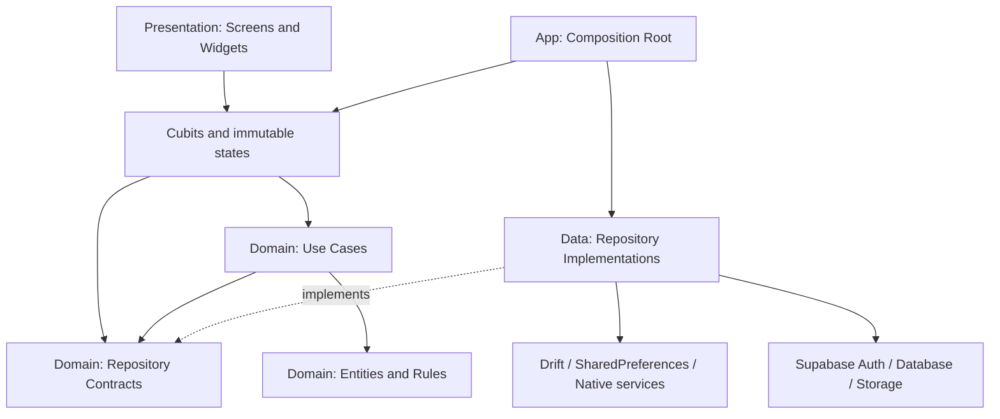

# Floosy: Clean Architecture + Cubit

المشروع مبني على طبقات منفصلة، وإدارة الحالة باستخدام `flutter_bloc`. الملف ده يوضح مسؤولية كل طبقة، وطريقة إضافة ميزة واختبارها.

## Dependency direction



Domain imports Dart, its own types, and value annotations. It has no dependency on Flutter, Supabase, Drift, Data, or Presentation. Freezed/JSON entities retain the existing serialization contract.

## Project structure

```text
lib/
  app/
    composition_root.dart        # Constructs concrete infrastructure
    app_repositories.dart        # Explicit bundle of domain contracts
    app_runtime.dart             # Owns Cubits and coordinates app events
    app_scope.dart               # BlocProvider / RepositoryProvider and lifetime
  domain/
    entities/                    # Financial values, items, cards, profiles, auth
    repositories/                # Repository and service contracts
    services/                    # Card ownership and balance rules
    usecases/                    # Application scenarios
  data/
    repositories/                # Contract implementations
    local/                       # Drift database and local data sources
    remote/                      # Supabase data sources
    services/                    # SMS ingestion, synchronization, image upload
  features/<feature>/presentation/
    cubit/                       # Feature state and commands
    screens/                     # Feature UI
    widgets/                     # Feature view components
  core/
    state/                       # LoadState, AsyncCubit, refresh coordination
    services/                    # App lock and platform services
    localization/                # Locale, theme, and selected-card Cubits
    theme/                       # Colors, icons, and appearance mapping
    widgets/                     # Shared UI components
  routing/
    app_routes.dart              # Route names without screen dependencies
    app_router.dart              # GoRouter configuration and access guards
```

## Use cases

| Use case | Responsibility |
| --- | --- |
| `LoadFinances` | Resolve a unique bank-qualified card and load its financial figures |
| `LoadItems` | Load items, confirmed usage quantities, and high-frequency indicators |
| `SaveItem` | Save details, upload newly selected local images, and record price changes |
| `SaveTransactionEdit` | Persist edits, learn card identity, and verify committed rows |
| `CreateManualTransaction` | Create a manual record with an explicit ID, source, and time |
| `DeleteTransaction` | Delete a record and recompute card transaction counts |
| `ConfigureCard` | Apply card settings while preserving balances on eligibility-only changes |
| `UpdateProfile` | Update the name and phone while retaining existing profile preferences |
| `LoadBudgets` | Combine budgets with actual category spending |
| `GetFinancialOverview` | Collect the financial facts used by the assistant |

Simple commands can call a domain repository contract directly from a Cubit. Multi-step scenarios and business decisions have explicit use cases. Repository implementations own atomic persistence, synchronization, and retries. `TransactionMovementReconciler` in Data rebuilds derived ledger movements after edits; the composition root only wires it into the repository.

## State ownership

- `AuthCubit` owns the session and pending authentication operations, including Google. Opening a browser is not a successful login; the real auth event completes the operation.
- `AppLockCubit` owns biometric preference loading, verification, and background relocking. Only a fresh sign-in event unlocks a session; refresh events and stream errors cannot replay an earlier sign-in.
- `FinanceCubit`, `CardsCubit`, and `ItemsCubit` own the shared financial, card, and item snapshots.
- `TransactionCommandsCubit` owns write-operation state. `TransactionsListCubit` owns local list loading, retained errors, and single-flight pull-to-refresh.
- `TransactionFilterCubit` controls display filtering independently of SMS ingestion.
- `ProfileCubit`, `BudgetsCubit`, `AnalyticsCubit`, `PocketCashCubit`, and `AIChatCubit` own their feature state.
- `ItemImageCubit` resolves a stored image reference to a display URL; its widget lifetime follows the image reference.
- `LocaleCubit`, `ThemeModeCubit`, and `SelectedCardCubit` persist preferences. Card selection emits the bank qualifier and last four digits together.

`LoadState<T>` represents loading, success, and failure while retaining displayed values during refresh. `AsyncCubit<T>` rejects obsolete results and ignores completion after closure.

`AppRuntime` coordinates streams outside widgets; Cubits do not subscribe directly to each other. `RefreshCubit` coalesces related write notifications. An account change clears the previous account's view state before new reads begin. Appearance and eye changes refresh card presentation without recalculating financial values.

Widgets retain transient form controllers, password visibility, and dialogs. Shared data, asynchronous command state, and business rules live in Cubits and Domain.

## Injection and lifecycle

`main.dart` initializes Supabase, creates `AppDependencies` and `AppRuntime`, and installs `AppScope`. Screens use `context.watch`, `BlocBuilder`, and `BlocListener` with explicitly imported feature Cubits.

The production scope owns its Runtime and closes subscriptions/Cubits before disposing infrastructure. Tests inject externally owned runtimes and close them explicitly. One SMS polling service lives for the application lifetime.

`SupabaseAccountRepository` translates SDK objects and failures into domain values. Session tokens and Google client secrets never enter presentation state. Existing database schemas, RLS, preference keys, and callback values remain compatible.

## Preserved behavior

- Cash item purchases retain the atomic Drift write for the transaction, expense, item usage, cash movement, and sync queue. State refresh follows the committed command.
- Usage percentage is the item's confirmed quantity divided by the total confirmed quantities across all items for the month.
- Cards sharing the same last four digits remain qualified by bank. Ambiguous legacy selection requires a user choice.
- Editing a stored image reference never treats it as a newly picked local file. A failed replacement upload preserves the old image.
- SMS parsing, duplicate protection, currency handling, and transaction timestamps continue through the existing Data services and regression tests.
- Google callbacks, biometric login, and saved locale/theme preferences keep their existing configuration.

## Adding a feature

1. Define domain values and a repository contract. Add a use case for scenarios with rules or multiple steps.
2. Implement the contract in Data, keeping SDK and storage details behind it.
3. Add a feature Cubit and immutable state; inject contracts/use cases through its constructor.
4. Register concrete dependencies in the composition root and choose the appropriate Cubit lifetime.
5. Let screens render state and invoke commands without importing Data implementations or SDKs.
6. Test rules and state transitions, plus UI/integration behavior where their wiring matters.

## Verification

```sh
flutter pub get
flutter analyze
flutter test
flutter build apk --debug --no-pub --target-platform android-arm64
```

`architecture_boundaries_test.dart` guards Domain's dependency direction and rejects Data/SDK/App imports from Presentation. Coordination tests cover account changes during reads, retained refresh values, biometric access, and visual card changes without financial recalculation. Financial/SMS regressions continue to exercise real in-memory Drift databases.

After changing Freezed entities or Drift definitions:

```sh
dart run build_runner build --delete-conflicting-outputs
```

Freezed/JSON generated files now live beside their entities in `domain/entities`. This architecture migration does not require recreating user data or changing the database schema.
